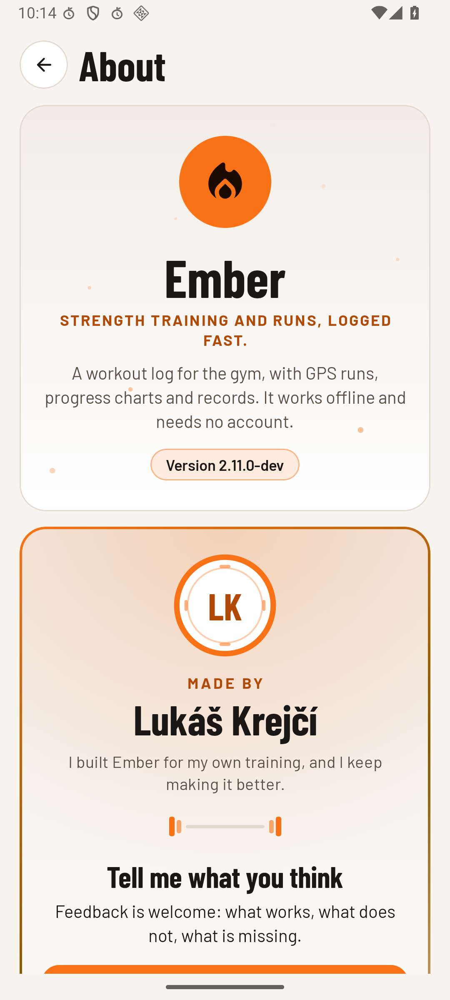

# Ember

Ember is an Android app for logging strength workouts and recording GPS runs. It works offline, keeps
all data on your phone and has no account. A web edition of the lifting part runs in the browser.



## Status

- Latest release: [v2.11.0](https://github.com/lukr-99/workout-tracker/releases/tag/v2.11.0),
  published 2026-11-12.
- `main` is at version 2.11.0 plus unreleased work: Czech language, accent colours and an About page.
  See `[Unreleased]` in [CHANGELOG.md](CHANGELOG.md).
- In daily personal use on one phone. Strength logging, Run Mode, backup and the updater are stable.
- The Spotify control only opens Spotify.
- The web edition is described in [docs/web-edition.md](docs/web-edition.md). It has no runs.

## Features

- Fast live logging: touch numpad, reps and kg, set types, RIR and RPE, timed sets, supersets and a
  rest timer.
- Templates, and an exercise catalog you can search and filter, with your own exercises and photos.
- Run Mode: live GPS runs on a dark map, with pace, splits and routes.
- Full history that you can edit after the fact.
- Progress: charts per exercise, personal records and a muscle recovery map.
- Backup and restore as JSON, CSV export, a Lyfta CSV importer, scheduled automatic backup and
  Health Connect sync.
- Settings for theme, accent colour, units and language (English or Czech).
- An About page with the version, the author, feedback links and credits.
- Optional Claude connector: with your approval, Claude can look at your training for a short time.
  See [docs/claude-connector.md](docs/claude-connector.md).

## Requirements

- Android 8.0 (API 26) or newer. Release builds are arm64 only.
- To build: JDK 17 or newer, Android SDK platform 35 and build-tools 35.
- Optional: Health Connect on the phone, and internet access for updates, catalog sync, map tiles and
  route snapping.
- Web edition: a current browser. The minimum versions are in [docs/web-edition.md](docs/web-edition.md).

## Install

Download the APK from the [latest release](https://github.com/lukr-99/workout-tracker/releases/latest)
and install it. After that, the in-app updater (Settings, Updates) installs new releases in place.

To give Ember to someone who does not code, build a phone installer on Windows:

```powershell
.\tools\make-phone-installer.ps1
```

Send them `dist/Ember-Phone-Installer-v*.zip`. They unzip it, connect a phone with USB debugging on
and double-click **Install Ember.cmd**. Their data is kept on upgrades.

To build from source and install a debug build on a connected phone:

```powershell
.\tools\build-and-install.ps1 -Launch
```

A debug build is its own app, **Ember dev**, so it never touches the data of the real Ember.

## Build and test

From the repository root, on Windows:

```powershell
.\gradlew.bat testDebugUnitTest lintDebug assembleDebug
```

The other checks (repository baseline, instrumented tests, screenshots, the emulator loop) are in
[CONTRIBUTING.md](CONTRIBUTING.md). On the owner's PC, CI runs locally in Kiln with the files in
`.kiln/workflows/`; see "CI with Kiln" in [AGENTS.md](AGENTS.md).

## Architecture

One Gradle module, `:app`, split into `domain/` (pure Kotlin), `data/` (Room and the repository),
`settings/`, `update/` and `ui/` (Compose). The web edition in `web/` compiles the same code to
WebAssembly. Modules, dependency direction and known limits are in
[ARCHITECTURE.md](ARCHITECTURE.md). The words the app uses are in [CONTEXT.md](CONTEXT.md).

## Data safety

- All data stays on the phone in a Room database, plus settings in DataStore and your exercise photos
  in the app's files. Nothing is sent anywhere unless you use the optional Claude connector.
- Schema changes use numbered Room migrations with no destructive fallback. Every schema is checked
  in under `app/schemas/` and covered by migration tests.
- **Backup:** Settings, Data, Save JSON (export format 1.14). It holds workouts, runs, routes,
  templates, exercises, photos and settings. Automatic backup writes daily or weekly into a folder you
  choose.
- **Restore:** import the file. You see a preview, then choose Merge or Replace everything. A failed
  restore changes nothing.
- **Delete all data:** in the danger zone at the end of the Data screen.
- The full rules are in [docs/data-contract.md](docs/data-contract.md). Recovery steps are in
  [SECURITY.md](SECURITY.md#recovery).

## Delivery

- **Release:** `com.lukr99.workout`, signed with the owner's keystore and published as a GitHub
  Release with the APK.
- **Debug:** `com.lukr99.workout.debug`, labelled Ember dev, version `x.y.z-dev`. It never updates
  itself.
- Signing, keystore backup and publishing steps are in [docs/RELEASING.md](docs/RELEASING.md).

## More documentation

- [docs/pitfalls.md](docs/pitfalls.md): mistakes this repository already made. Search it first.
- [docs/rework/README.md](docs/rework/README.md) and [docs/run-mode/README.md](docs/run-mode/README.md):
  how the v2 rewrite and Run Mode were built.
- Version 1 was a .NET MAUI proof of concept. It lives on the `release/1.0` branch and the `v1.0.0`
  tag.

## License

[PolyForm Noncommercial 1.0.0](LICENSE.md). Free for personal and non-commercial use. Selling it or
other commercial use needs permission.

The app bundles the Barlow and Barlow Condensed fonts (Copyright 2017 The Barlow Project Authors)
under the SIL Open Font License 1.1. The licence ships in the app as `assets/licenses/barlow-OFL.txt`.
